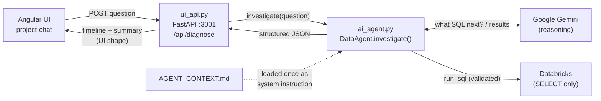
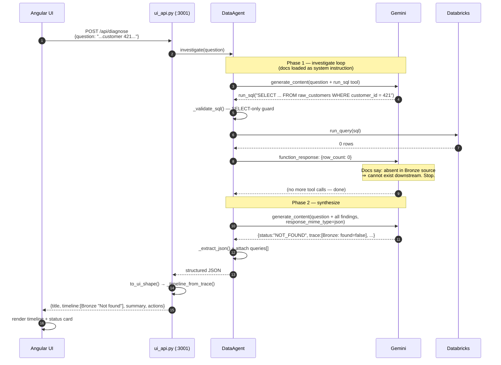

# How the AI Agent Works — End to End

This document explains how a user's question travels from the UI, through the
generic agent, out to Gemini and Databricks, and back to the screen. Two files do
the work:

| File | Role |
|------|------|
| `src/ui_api.py`  | Thin HTTP layer. Serves `POST /api/diagnose` on port **3001**, calls the agent, and maps its generic output to the shape the Angular UI renders. **Presentation only — no investigation logic.** |
| `src/ai_agent.py` | The generic agent (`DataAgent`). Runs the investigation: lets Gemini decide what SQL to run against Databricks, then synthesizes a structured JSON answer. **Knows nothing project-specific — everything comes from `AGENT_CONTEXT.md`.** |

The key idea: **the code is generic plumbing; all "which tables, what order, when to
stop" intelligence comes from the model reading the documentation.** Swap the docs,
and the behaviour follows — no code changes.

---

## Component overview



---

## The two phases inside `DataAgent.investigate()`

1. **Investigate loop** — Gemini is given the documentation and a single SELECT-only
   `run_sql` tool. It decides which table to query next (reading the documented data
   flow), the code runs the SQL and feeds the result back. Repeats until the model
   stops asking for queries (capped at `MAX_SQL_CALLS = 12`).
2. **Synthesize** — one final Gemini call (no tools) turns all the collected query
   results into a single JSON object: `status`, `summary`, `entity`, `trace[]`,
   `root_cause`, `queries[]`.

---

## End-to-end example

**Question:** *"Track whether customer 421 present in all layers"*
**Outcome:** customer 421 is absent from Bronze, so the agent **stops there** (a rule
it infers from the docs, not from code) and reports `NOT_FOUND`.



### What the user sees

> **421 - Tracking Results**
> ○ **Bronze** `test_catalog.default.raw_customers` — **Not found**
> &nbsp;&nbsp;&nbsp;Customer ID 421 is missing from the raw customer source records.
>
> **Status: NOT_FOUND** — Customer 421 is not present in the platform because it is
> missing from its source table, `raw_customers`. It is genuinely absent and does not
> flow through any subsequent layers.

Contrast: for a customer that *is* present (e.g. 42), the loop runs three times —
Bronze → Silver → Gold — each returning rows, and the final status is `COMPLETE`.

---

## Function call chain (quick reference)

```
ui_api.diagnose()
 └─ DataAgent.investigate()
     ├─ loop (max 12):
     │    client.models.generate_content()   # Gemini: asks for SQL or stops
     │    _function_calls()                   # pull the run_sql call out
     │    _run_sql()
     │        ├─ _validate_sql()              # SELECT-only guard
     │        └─ run_query()                  # db_connection.py → Databricks
     │    (feed result back to Gemini)
     ├─ _synthesize()
     │    ├─ _findings_text()                 # flatten all SQL + results
     │    ├─ generate_content()               # Gemini: JSON answer (no tools)
     │    └─ _extract_json()
     └─ return dict (status, summary, entity, trace[], root_cause, queries[])

ui_api.to_ui_shape()
 └─ _timeline_from_trace()                    # label each layer Found/Stuck/Not found
                                              # → {title, timeline, summary, actions}
```

---

## Why this is generic

- **Table names, join keys, layer order, drop filters** → all in `AGENT_CONTEXT.md`.
- **"Don't check downstream if absent upstream"** → stated in the docs *and* reinforced
  as a general principle in the agent's system instruction. Neither is a Python branch.
- **No entity types are hard-coded** (customer/order/product come from the docs).
- To point the agent at a different project, change the docs (or the `DOC_FILES`
  env var) — the code stays the same.

---

## Running it

```bash
cd databricks-ai-gateway

# API the UI talks to (port 3001)
./venv/bin/uvicorn src.ui_api:app --port 3001 --reload

# Or test the agent directly from the CLI
./venv/bin/python -m src.ai_agent "Track whether customer 421 present in all layers"
```
