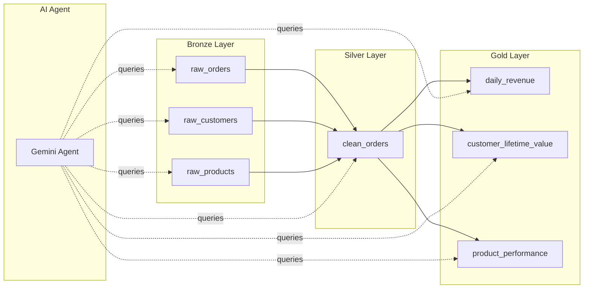
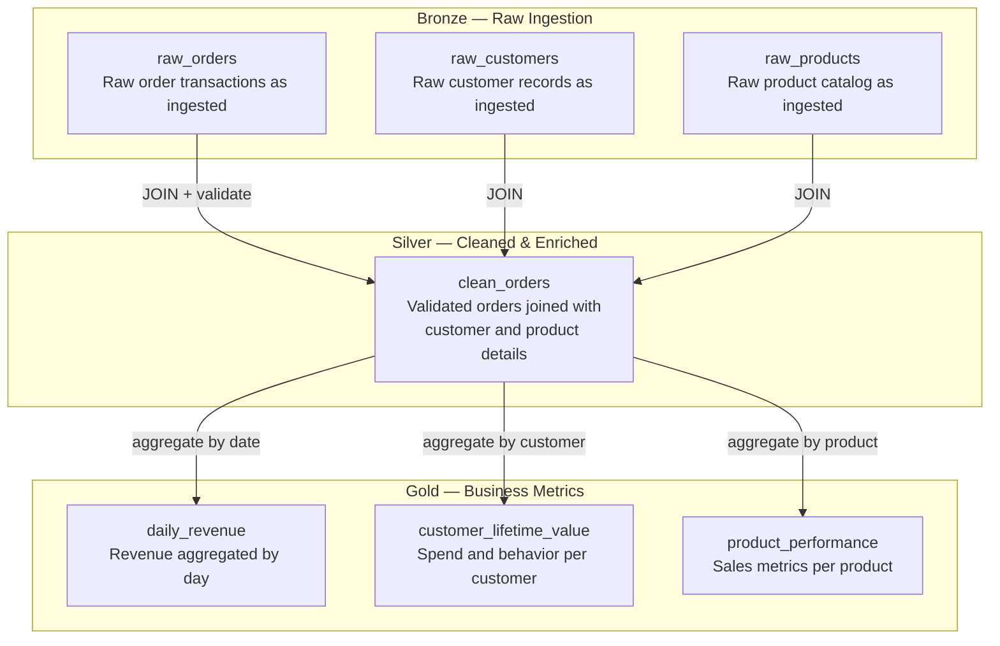
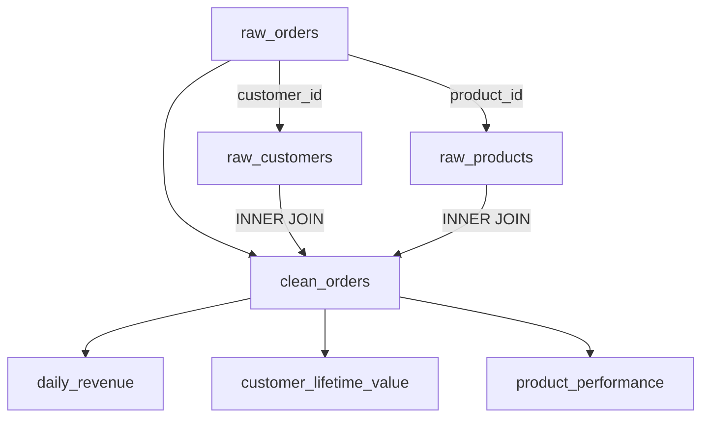

# E-Commerce Data Platform — Databricks Medallion Architecture

## Project Overview

This project builds an end-to-end data engineering platform for an e-commerce business using Databricks. It processes raw transactional data through a **Medallion Architecture** (Bronze → Silver → Gold) to produce business-ready analytics.

An **AI agent** powered by Google Gemini understands the system by reading this documentation and the pipeline code. **This project is scoped to data lineage tracking only:** the agent answers questions about whether a specific entity (a customer, order, or product) flows through the Bronze, Silver, and Gold layers, and where it was dropped. It queries the Databricks tables directly to trace the entity and declines general analytics questions (totals, top-N, trends).

### Business Problem

The e-commerce business needs a unified data platform that:
- Ingests raw transactional data (orders, customers, products) into a raw landing zone
- Cleans and enriches the data into a reliable, queryable format
- Produces aggregated business metrics for revenue tracking, customer analytics, and product performance
- Allows non-technical stakeholders to ask questions about the data in plain English

### Key Objectives

1. Build a scalable medallion pipeline that handles raw data ingestion, cleaning, and aggregation
2. Maintain full data lineage so any metric can be traced back to its source
3. Provide an AI-powered interface for exploring and investigating the data

---

## Architecture



---

## Data Flow



---

## Tables

### Bronze Layer

Raw data ingested as-is from source systems. No cleaning or validation is applied.

- **`test_catalog.default.raw_orders`** — Order transactions from all source systems
- **`test_catalog.default.raw_customers`** — Customer records
- **`test_catalog.default.raw_products`** — Product catalog

### Silver Layer

Cleaned, validated, and enriched data. Multiple Bronze sources are joined and transformed here.

- **`test_catalog.default.clean_orders`** — Enriched order data combining orders, customers, and products. Pipeline: `scripts/build_pipeline.py`

### Gold Layer

Business-ready aggregated metrics derived from the Silver layer.

- **`test_catalog.default.daily_revenue`** — Revenue and order metrics aggregated by day
- **`test_catalog.default.customer_lifetime_value`** — Customer spend, tenure, and behavior metrics
- **`test_catalog.default.product_performance`** — Product sales, revenue, and reach metrics

Pipeline for all Gold tables: `scripts/build_pipeline.py`

---

## Table & Column Reference

Complete schema for every table, at table and column level. The agent uses this section for all table and column metadata and does not run `DESCRIBE TABLE` or `SHOW TABLES` to discover structure.

Notes:
- Data types are Spark SQL types. Databricks does not enforce `PRIMARY KEY` / `FOREIGN KEY` constraints here; the "Key" column documents the **logical** keys and relationships.
- `COUNT`/`SUM` of integer columns return `BIGINT`; `ROUND(...)`, `AVG(...)`, and sums of `DOUBLE` columns return `DOUBLE`.

### Bronze

#### `test_catalog.default.raw_orders`
Raw order transactions as received from source systems. No cleaning applied — may contain duplicates, NULLs, invalid dates, and orphan references. **Grain:** one row per ingested order record (duplicates possible).

| Column | Type | Key | Description |
|--------|------|-----|-------------|
| `order_id` | INT | PK (not unique in Bronze — duplicates exist) | Order identifier |
| `customer_id` | INT | FK → `raw_customers.customer_id` | Ordering customer (may reference a non-existent customer, 900–999) |
| `product_id` | INT | FK → `raw_products.product_id` | Ordered product (may reference a non-existent product, 900–999) |
| `quantity` | INT | | Units ordered (may be NULL or ≤ 0 in raw) |
| `order_date` | STRING | | Order date as text `YYYY-MM-DD` (may be `'INVALID'` or a future date) |
| `order_status` | STRING | | One of `completed`, `shipped`, `processing`, `cancelled`, `returned` |
| `payment_method` | STRING | | One of `credit_card`, `debit_card`, `paypal`, `bank_transfer`, `gift_card` |
| `source_system` | STRING | | Ingestion source: `web_app`, `mobile_app`, `pos_terminal`, `partner_api` |
| `region` | STRING | | One of `East`, `West`, `North`, `South`, `Central` (may be NULL) |
| `ingested_at` | TIMESTAMP | | When the row was ingested into Bronze (audit timestamp) |

#### `test_catalog.default.raw_customers`
Raw customer master records. **Grain:** one row per customer.

| Column | Type | Key | Description |
|--------|------|-----|-------------|
| `customer_id` | INT | PK | Customer identifier (1–200) |
| `first_name` | STRING | | Customer first name |
| `last_name` | STRING | | Customer last name |
| `email` | STRING | | Email address (may be NULL, ~5%) |
| `phone` | STRING | | Phone number (may be NULL, ~3%) |
| `city` | STRING | | City |
| `state` | STRING | | US state (2-letter code) |
| `country` | STRING | | Country (always `US`) |
| `signup_date` | STRING | | Signup date as text `YYYY-MM-DD` |
| `source_system` | STRING | | Acquisition source: `web_app`, `mobile_app`, `pos_terminal`, `partner_api` |
| `ingested_at` | TIMESTAMP | | When the row was ingested into Bronze (audit timestamp) |

#### `test_catalog.default.raw_products`
Raw product catalog. **Grain:** one row per product.

| Column | Type | Key | Description |
|--------|------|-----|-------------|
| `product_id` | INT | PK | Product identifier (1–50) |
| `product_name` | STRING | | Product name |
| `category` | STRING | | One of `Electronics`, `Clothing`, `Home & Kitchen`, `Sports`, `Books`, `Beauty` |
| `brand` | STRING | | Brand name |
| `unit_price` | DOUBLE | | Price per unit (may be 0 or negative in raw, ~4%) |
| `weight_kg` | DOUBLE | | Product weight in kilograms |
| `source_system` | STRING | | Ingestion source |
| `ingested_at` | TIMESTAMP | | When the row was ingested into Bronze (audit timestamp) |

### Silver

#### `test_catalog.default.clean_orders`
Validated, deduplicated, enriched order lines — `raw_orders` joined to `raw_customers` and `raw_products`. **Grain:** one row per valid `order_id` (deduplicated to the latest ingestion). Built by `scripts/build_pipeline.py`.

| Column | Type | Key | Description |
|--------|------|-----|-------------|
| `order_id` | INT | PK (unique after dedup) | Order identifier |
| `customer_id` | INT | FK → `raw_customers.customer_id` | Ordering customer |
| `first_name` | STRING | | Customer first name (from `raw_customers`) |
| `last_name` | STRING | | Customer last name (from `raw_customers`) |
| `customer_name` | STRING | | `first_name` + `' '` + `last_name` |
| `customer_city` | STRING | | Customer city (from `raw_customers.city`) |
| `customer_state` | STRING | | Customer state (from `raw_customers.state`) |
| `product_id` | INT | FK → `raw_products.product_id` | Ordered product |
| `product_name` | STRING | | Product name (from `raw_products`) |
| `product_category` | STRING | | Product category (from `raw_products.category`) |
| `product_brand` | STRING | | Product brand (from `raw_products.brand`) |
| `quantity` | INT | | Units ordered (always > 0 here) |
| `unit_price` | DOUBLE | | Price per unit (always > 0 here, from `raw_products`) |
| `line_total` | DOUBLE | | `ROUND(quantity * unit_price, 2)` — revenue for this line |
| `order_date` | DATE | | Order date (valid, ≤ current date) |
| `order_month` | INT | | Month of `order_date` (1–12) |
| `order_year` | INT | | Year of `order_date` |
| `order_status` | STRING | | Order status (carried from Bronze) |
| `payment_method` | STRING | | Payment method (carried from Bronze) |
| `region` | STRING | | Region (carried from Bronze, non-NULL here) |
| `source_system` | STRING | | Source system (carried from Bronze) |
| `processed_at` | TIMESTAMP | | When this Silver row was built (audit timestamp) |

### Gold

#### `test_catalog.default.daily_revenue`
Revenue and order metrics aggregated by day, from `clean_orders` (excludes `cancelled`/`returned`). **Grain:** one row per `order_date`.

| Column | Type | Key | Description |
|--------|------|-----|-------------|
| `order_date` | DATE | PK | The day being summarized |
| `order_year` | INT | | Year of `order_date` |
| `order_month` | INT | | Month of `order_date` (1–12) |
| `total_orders` | BIGINT | | Count of orders that day |
| `total_units_sold` | BIGINT | | Sum of `quantity` that day |
| `total_revenue` | DOUBLE | | Sum of `line_total` that day |
| `avg_order_value` | DOUBLE | | Average `line_total` that day |
| `unique_customers` | BIGINT | | Distinct customers that day |
| `aggregated_at` | TIMESTAMP | | When this Gold row was built (audit timestamp) |

#### `test_catalog.default.customer_lifetime_value`
Per-customer spend, tenure, and behavior, from `clean_orders` (excludes `cancelled`/`returned`). **Grain:** one row per `customer_id`.

| Column | Type | Key | Description |
|--------|------|-----|-------------|
| `customer_id` | INT | PK | Customer identifier |
| `customer_name` | STRING | | Customer full name |
| `customer_city` | STRING | | Customer city |
| `customer_state` | STRING | | Customer state |
| `total_orders` | BIGINT | | Lifetime order count |
| `total_items_purchased` | BIGINT | | Lifetime sum of `quantity` |
| `total_spent` | DOUBLE | | Lifetime sum of `line_total` |
| `avg_order_value` | DOUBLE | | Average `line_total` across orders |
| `first_order_date` | DATE | | Earliest `order_date` |
| `last_order_date` | DATE | | Latest `order_date` |
| `customer_tenure_days` | INT | | Days between first and last order |
| `categories_purchased` | BIGINT | | Distinct product categories purchased |
| `aggregated_at` | TIMESTAMP | | When this Gold row was built (audit timestamp) |

#### `test_catalog.default.product_performance`
Per-product sales, revenue, and reach, from `clean_orders` (excludes `cancelled`/`returned`). **Grain:** one row per `product_id`.

| Column | Type | Key | Description |
|--------|------|-----|-------------|
| `product_id` | INT | PK | Product identifier |
| `product_name` | STRING | | Product name |
| `product_category` | STRING | | Product category |
| `product_brand` | STRING | | Product brand |
| `total_orders` | BIGINT | | Number of orders containing this product |
| `total_quantity_sold` | BIGINT | | Total units sold |
| `total_revenue` | DOUBLE | | Sum of `line_total` for this product |
| `avg_order_value` | DOUBLE | | Average `line_total` for this product |
| `avg_unit_price` | DOUBLE | | Average `unit_price` for this product |
| `unique_customers` | BIGINT | | Distinct customers who bought it |
| `regions_sold_in` | BIGINT | | Distinct regions it sold in |
| `aggregated_at` | TIMESTAMP | | When this Gold row was built (audit timestamp) |

---

## Data Lineage



To trace any Gold metric back to its source, follow the lineage through `clean_orders` back to the Bronze tables. The transformation logic is defined in `scripts/build_pipeline.py`.

---

## Join Keys

All joins between tables use these keys.

| Relationship                        | Key column    | Join type   |
|-------------------------------------|---------------|-------------|
| `raw_orders` → `raw_customers`      | `customer_id` | INNER JOIN  |
| `raw_orders` → `raw_products`       | `product_id`  | INNER JOIN  |
| `clean_orders` → `customer_lifetime_value` | `customer_id` | aggregation |
| `clean_orders` → `product_performance`     | `product_id`  | aggregation |
| `clean_orders` → `daily_revenue`           | `order_date`  | aggregation |

> **ID format:** `customer_id`, `order_id`, and `product_id` are integers. Do not quote them in SQL.

---

## Entity Lineage & Tracking

Each business entity flows through a specific set of tables. To check whether an entity is present across the layers, query these tables in order (Bronze → Silver → Gold):

| Entity   | Key column    | Bronze          | Silver         | Gold                       |
|----------|---------------|-----------------|----------------|----------------------------|
| Customer | `customer_id` | `raw_customers` | `clean_orders` | `customer_lifetime_value`  |
| Order    | `order_id`    | `raw_orders`    | `clean_orders` | `daily_revenue` (aggregated by date) |
| Product  | `product_id`  | `raw_products`  | `clean_orders` | `product_performance`      |

An entity is "Found" at a layer if at least one matching row exists. If it exists in an earlier layer but not a later one, it was dropped ("Stuck") by a transformation between them.

### Lineage tracing procedure

Trace an entity one layer at a time, in Medallion order (Bronze → Silver → Gold). Check a single layer, read its result, then decide the next step:

1. Start at the entity's Bronze source table and run a presence check (count of matching rows, plus the latest audit timestamp).
2. After each layer's result, decide whether to continue:
   - If the entity was **not** found in the layer just checked (count = 0), **stop** — do not check any later layer. Later layers are derived from this one, so the entity cannot appear downstream.
   - If the entity **was** found, continue to the next layer in order.
3. Stop once the Gold layer has been checked, or as soon as a layer returns no match — whichever comes first.

Only the layers actually checked are reported; the trace ends at the first layer where the entity is absent.

### Interpreting presence across layers

State the conclusion based on where the entity appears, in Bronze → Silver → Gold order:

- Found in Bronze means it exists — never report "not found"/"missing" just because it is absent from Silver or Gold.
- Present earlier but absent later means it was dropped by a transformation: name the first layer where it disappears and the responsible filter/join from "Where records get dropped".
- It is genuinely absent only when it is missing from its Bronze source table.

### Where records get dropped (Bronze → Silver → Gold)

These filters in `scripts/build_pipeline.py` explain why an entity may be present in Bronze but missing downstream:

**Bronze → Silver (`clean_orders`):**
- `quantity IS NULL` or `quantity <= 0` — invalid quantity
- `region IS NULL` — missing region
- `order_date` not castable to DATE, or in the future — invalid date
- Duplicate `order_id` — only the latest by `ingested_at` is kept (`ROW_NUMBER() = 1`)
- **INNER JOIN to `raw_customers`** — an order whose `customer_id` has no matching customer is dropped (orphan customer)
- **INNER JOIN to `raw_products`** — an order whose `product_id` has no matching product is dropped (orphan product)
- `unit_price <= 0` — invalid price

**Silver → Gold (all metrics):**
- `order_status IN ('cancelled', 'returned')` — excluded from every Gold aggregate

### Audit timestamps per layer

Used to report when an entity was last seen at each layer:
- Bronze: `ingested_at`
- Silver (`clean_orders`): `processed_at`
- Gold: `aggregated_at`

---

## Project Structure

```
├── scripts/
│   ├── generate_data.py      # Generates synthetic data and loads Bronze tables
│   └── build_pipeline.py     # Builds Silver and Gold tables from Bronze
├── notebooks/
│   ├── 01_generate_bronze.py # Databricks job: generate data → Bronze
│   ├── 02_build_silver.py    # Databricks job: Bronze → Silver
│   └── 03_build_gold.py      # Databricks job: Silver → Gold
├── src/
│   ├── db_connection.py       # Databricks connection module
│   └── agent.py               # AI investigation agent
├── .env                       # Credentials (not committed)
└── DATA_PLATFORM.md           # This file (platform docs the agent reads)
```

---

## AI Agent

The AI agent reads this documentation and the pipeline code (`scripts/build_pipeline.py`) to understand the system. It gets all table and column metadata (names, data types, keys, relationships) from this document, not by running `SHOW TABLES` or `DESCRIBE TABLE`; it only runs `SELECT` queries to read actual data when answering a question.

The agent answers **lineage questions only** — questions about whether a specific entity (a particular customer, order, or product, named by its id) flows through the layers (e.g. *"is customer 42 present in all layers?"*, *"where did order 1234 get stuck?"*). For each such question it:

1. Identifies the entity (type + id)
2. Checks for its presence at each layer (Bronze → Silver → Gold) using the Entity Lineage map above
3. Builds a layer-by-layer timeline (Found / Stuck / Not found) and, if the entity was dropped, names the transformation step responsible
4. Returns a structured JSON object (timeline, summary, actions) and prints a tick-by-tick view in the terminal

Any question that is not about a specific entity's lineage (for example general analytics such as totals, top-N, or trends) is declined with a short message directing the user to ask a lineage question. The agent restricts itself to SELECT queries only.
