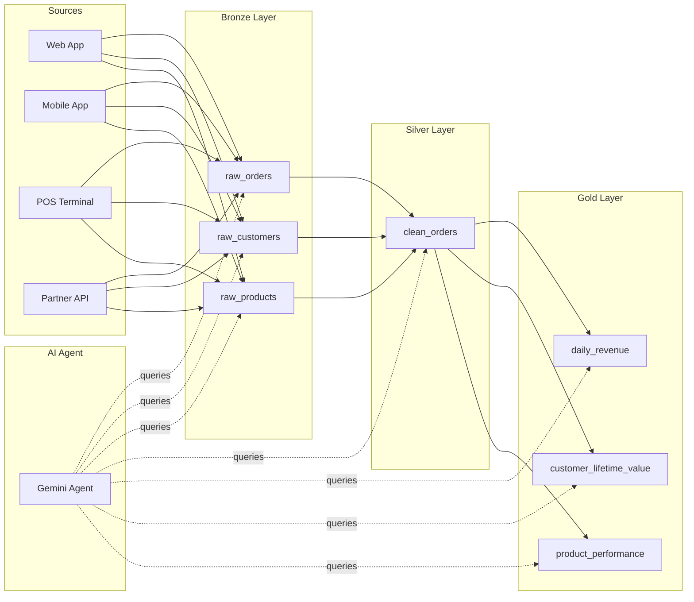
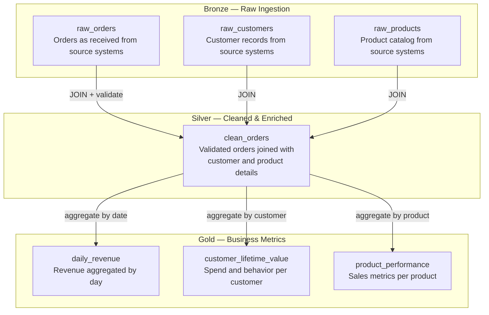
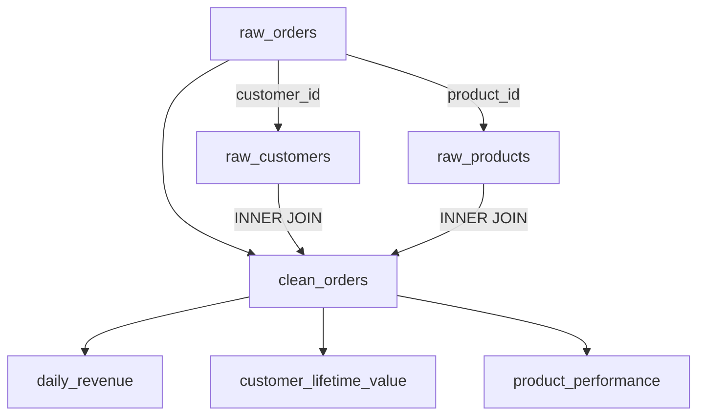

# E-Commerce Data Platform — Databricks Medallion Architecture

## Project Overview

This project builds an end-to-end data engineering platform for an e-commerce business using Databricks. It processes raw transactional data through a **Medallion Architecture** (Bronze → Silver → Gold) to produce business-ready analytics.

An **AI agent** powered by Google Gemini understands the system by reading this documentation and the pipeline code. It can answer natural language questions about the data by querying the Databricks tables directly.

### Business Problem

The e-commerce business needs a unified data platform that:
- Ingests raw data from multiple source systems (web app, mobile app, POS terminals, partner APIs)
- Cleans and enriches the data into a reliable, queryable format
- Produces aggregated business metrics for revenue tracking, customer analytics, and product performance
- Allows non-technical stakeholders to ask questions about the data in plain English

### Key Objectives

1. Build a scalable medallion pipeline that handles raw data ingestion, cleaning, and aggregation
2. Maintain full data lineage so any metric can be traced back to its source
3. Provide an AI-powered interface for exploring and investigating the data

---

## Architecture



---

## Data Flow



---

## Tables

### Bronze Layer

Raw data ingested as-is from source systems. No cleaning or validation is applied.

- **`test_catalog.default.raw_orders`** — Order transactions from all source systems
- **`test_catalog.default.raw_customers`** — Customer records
- **`test_catalog.default.raw_products`** — Product catalog

### Silver Layer

Cleaned, validated, and enriched data. Multiple Bronze sources are joined and transformed here.

- **`test_catalog.default.clean_orders`** — Enriched order data combining orders, customers, and products. Pipeline: `scripts/build_pipeline.py`

### Gold Layer

Business-ready aggregated metrics derived from the Silver layer.

- **`test_catalog.default.daily_revenue`** — Revenue and order metrics aggregated by day
- **`test_catalog.default.customer_lifetime_value`** — Customer spend, tenure, and behavior metrics
- **`test_catalog.default.product_performance`** — Product sales, revenue, and reach metrics

Pipeline for all Gold tables: `scripts/build_pipeline.py`

---

## Data Lineage



To trace any Gold metric back to its source, follow the lineage through `clean_orders` back to the Bronze tables. The transformation logic is defined in `scripts/build_pipeline.py`.

---

## Project Structure

```
├── scripts/
│   ├── generate_data.py      # Generates synthetic data and loads Bronze tables
│   └── build_pipeline.py     # Builds Silver and Gold tables from Bronze
├── src/
│   ├── db_connection.py       # Databricks connection module
│   └── agent.py               # AI investigation agent
├── .env                       # Credentials (not committed)
└── README.md                  # This file
```

---

## AI Agent

The AI agent reads this documentation and the pipeline code (`scripts/build_pipeline.py`) to understand the system. When asked a question, it:

1. Determines which tables are relevant
2. Generates SQL queries to investigate
3. Executes queries against Databricks
4. If needed, generates follow-up queries for deeper investigation
5. Explains the results using its understanding of the architecture and pipeline logic

The agent restricts itself to SELECT queries only.
