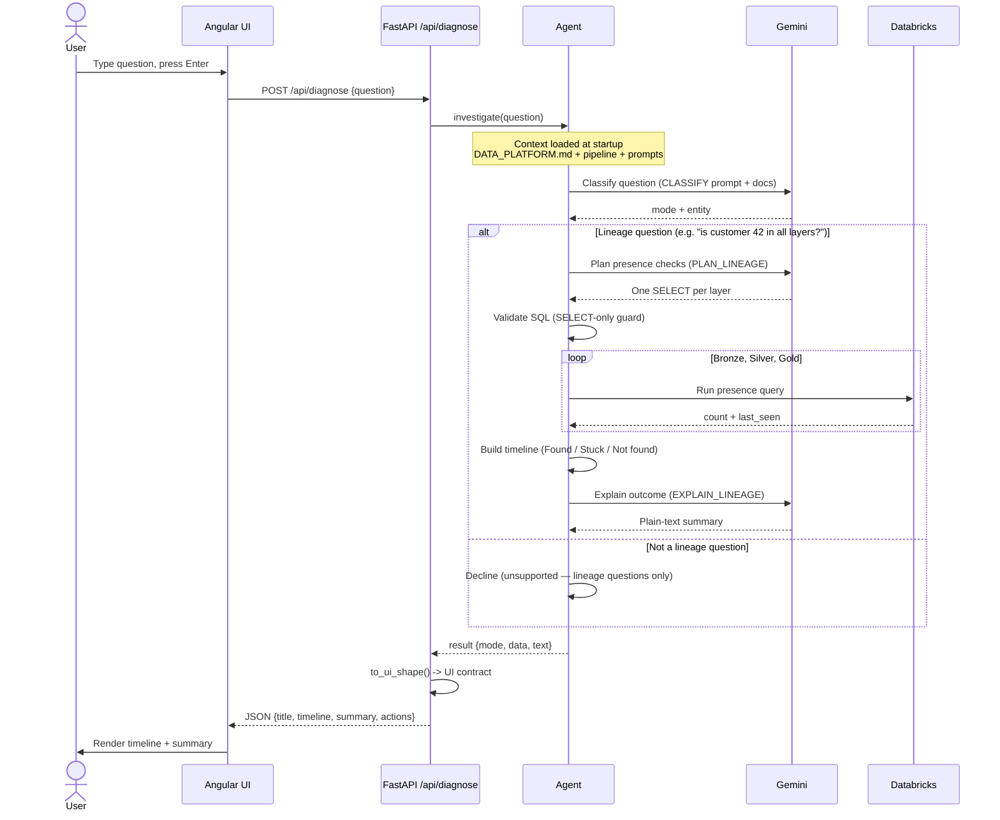
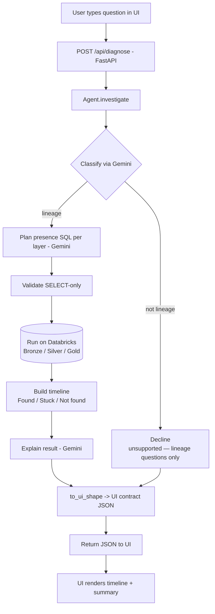

# System Flow — Prompt to Result

How a question travels from the UI through the agent and back, and how the agent
uses Gemini and Databricks to answer it.

At startup the agent loads its context once: `DATA_PLATFORM.md` (tables, columns,
keys, lineage), `build_pipeline.py` (transformations), and the prompt templates in
`prompts.py`. Every Gemini call includes this context.

## Sequence diagram

## Flowchart

